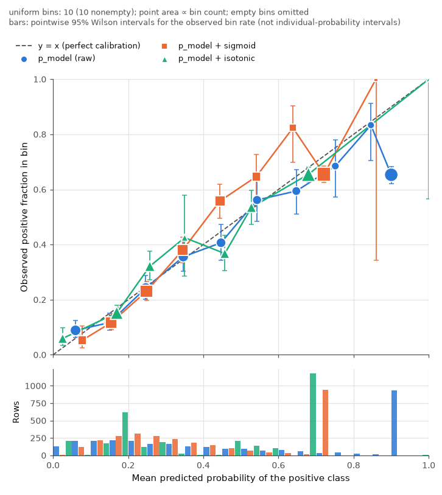

# CalibCheck

**How trustworthy are your model's probabilities?**

Suppose a model says "90%" for a group of cases and only about 65% of them turn out positive.
Ranking metrics such as ROC-AUC will not show this, because the order of the cases can still be
right. CalibCheck is a local-first Python tool that checks whether a binary classifier's
predicted probabilities match observed event frequencies. It reports uncertainty, compares
models on identical rows, and supports recalibration with separate data. Results export as
JSON and as an offline HTML report.



*Synthetic demo (`calibcheck demo`, seed 7). On 3,000 held-out test rows, the raw model's
[0.9, 1.0] bin holds 937 rows with mean prediction 0.900 and observed rate 0.653 (95% Wilson
interval 0.622–0.683). The generator's true rate for that cohort is 0.65. Fitted on 3,000
separate calibration rows, the isotonic map changes test Brier loss by −0.0173 (95% paired
percentile bootstrap, 2,000 replicates: −0.0214 to −0.0129). See
[methodology](docs/methodology.md).*

> **Status:** v0.1.0, alpha. It is not published on PyPI; install from this repository. The name
> `calibcheck` was unregistered on PyPI when checked on 2026-10-18, but no release has been made.

## Why not just call scikit-learn?

scikit-learn provides the building blocks: `brier_score_loss`, `log_loss`, `calibration_curve`
and `IsotonicRegression`. CalibCheck adds the workflow around them:

* **Strict input contract.** You declare the positive label and name the probability columns.
  Out-of-range values, percentages, logits, duplicate IDs and missing outcomes are rejected or
  explicitly recorded. Nothing is silently repaired.
* **Exact, inspectable bins.** Bin edges and boundary rules are exact, empty bins are kept, the
  requested and actual quantile bin counts are both reported, and a sensitivity table covers
  several partitions.
* **Uncertainty with stated assumptions.** Pointwise Wilson intervals cover bin rates and a
  seeded bootstrap covers aggregate losses. If you declare dependent observations, these
  intervals are refused rather than faked.
* **Paired comparisons.** Models are compared on identical rows, and the intervals are computed
  on the difference itself. If metrics disagree, no winner is declared.
* **Data-role protocol for recalibration.** Calibration/test overlap is blocked, method
  selection runs only on calibration folds, and artifacts are inspectable JSON (never pickle).
* **Portable evidence.** Outputs include versioned JSON with `null` plus a reason code
  (never NaN), formula-safe CSVs, a self-contained offline HTML report, a run manifest and
  rule-based findings with caveats. No language model is used and no data leaves the machine.

## Install (from the repository)

```bash
git clone https://github.com/Kutnkor/calibcheck.git
cd calibcheck
python3 -m venv .venv && source .venv/bin/activate
pip install -e .            # core: CLI + library
pip install -e '.[app]'     # optional local browser interface (Streamlit)
pip install -e '.[dev]'     # tests, lint, type checks
```

Python 3.11 or newer is required. Tested locally on macOS (arm64) with Python 3.11.1, and with
3.13.7 from a clean wheel install. The CI configuration targets 3.11–3.13 on Linux, plus macOS
and Windows smoke jobs. **It has not been run on GitHub yet.** See
[docs/acceptance.md](docs/acceptance.md).

## Quickstart

```bash
calibcheck demo --out calibcheck-demo     # synthetic walkthrough, fully offline
open calibcheck-demo/reports/recalibration/report.html
```

Evaluate your own predictions:

```bash
calibcheck inspect predictions.csv --label y_true --prob p_model_a --id row_id
calibcheck report predictions.csv --label y_true --prob p_model_a --id row_id --out reports/example
```

Expected CSV (one row per observation):

| row_id | y_true | p_model_a | p_model_b | channel |
|---|---|---|---|---|
| 000001 | 1 | 0.44 | 0.46 | app |
| 000002 | 0 | 0.02 | 0.09 | web |

* `y_true`: the outcome. If the labels are not 0/1, declare the event with `--positive-label yes`.
* `p_*`: the probability **of the positive label**, P(y_true = positive), in [0, 1].
  CalibCheck never guesses which columns are probabilities.
* `row_id`: unique, kept as text (leading zeros survive). It is optional, but required for
  joining files and checking data roles.
* Optional columns: subgroups (`--group`), `--entity`, `--timestamp`.

`calibcheck example` writes a small bundled synthetic file you can try these commands on.

`report` writes:

```
reports/example/
  report.html            self-contained, offline
  report.json            versioned results (schema 1.0)
  summary.txt, config.toml (resolved settings; reproduce with --config)
  tables/metrics.csv, bins.csv, binning_sensitivity.csv, findings.csv, [groups.csv, comparisons.csv]
  figures/reliability.png
  export_manifest.json   file list and SHA-256; "complete": true only when every step succeeded
```

Useful options:

* `--bootstrap`: intervals for Brier and log loss.
* `--strategy quantile`, `--bins 20`: change the binning.
* `--group channel`: subgroup diagnostics.
* `--dependence entity_clustered`: disables IID intervals.
* `--privacy public`: omits paths, fingerprints and group names, and suppresses small cells.
* `--drop-invalid`: drops invalid rows instead of failing, with every exclusion recorded.

## Compare models on the same rows

```bash
calibcheck compare predictions.csv --prob p_model_a --prob p_model_b --id row_id --bootstrap
# separate files are joined by unique ID; unmatched rows require --intersection
calibcheck compare a.csv --prob p_a --id row_id --other b.csv --other-prob p_b
```

## Recalibrate with separate data

```bash
calibcheck fit calibration.csv --prob p_model --id row_id --method isotonic --out isotonic.json
calibcheck apply new_predictions.csv --artifact isotonic.json --prob p_model --id row_id --out scored.csv
calibcheck recalibrate --calibration calibration.csv --test test.csv --prob p_model --id row_id \
    --method sigmoid --method isotonic --bootstrap --out reports/recal
```

* Overlapping calibration and test IDs stop the run (exit code 3).
* `--mode selected` picks a method on inner folds of the calibration data and evaluates it once.
* The available methods are `identity`, `sigmoid` (logit-affine sigmoid), `isotonic` and
  `temperature`.

## Python API

```python
from calibcheck import analyze_predictions, fit_calibrator, apply_calibrator

res = analyze_predictions("predictions.csv",
                          columns={"label": "y_true", "probs": ["p_model_a"], "id": "row_id"},
                          uncertainty={"bootstrap": True})
res.model("p_model_a").metrics["ece"].value        # binned positive-class ECE
res.metrics_table()                                 # rows for a DataFrame
```

See [docs/api.md](docs/api.md) and [examples/api_example.py](examples/api_example.py).

## Local browser interface

```bash
pip install -e '.[app]'
calibcheck app      # http://127.0.0.1:8501, bound to this machine only
```

The app uses the same engine as the CLI. Uploaded files stay in session memory on the machine
running the app, with no telemetry. If you host the app on a server, that server receives the
uploads.

## What the numbers mean (and don't)

* **Brier and log loss** are overall scores. A lower value does not prove better calibration.
* **Binned ECE** depends on the partition. It is always shown with its binning, and no threshold
  certifies a model.
* **Interval bars** describe aggregate statistics such as a bin's observed rate. They are not
  uncertainty about any individual's probability.
* **Subgroup differences** are descriptive. They are not causal or legal fairness findings.

Details: [docs/methodology.md](docs/methodology.md).

## Evidence in this repository

* `tests/`: 245 tests. They cover hand-checked values, scikit-learn and SciPy cross-checks,
  property tests, data-role protocol tests, CLI and API agreement, offline HTML checks and the app.
* [experiments/results/SUMMARY.md](experiments/results/SUMMARY.md): recalibration on 7 synthetic
  scenarios × 20 seeds, plus base models on synthetic tabular data, Breast Cancer Wisconsin
  (CC BY 4.0) and UCI Adult (CC BY 4.0, opt-in download). This includes negative results:
  isotonic recalibration made already-calibrated models worse on test log loss in 20 of 20 runs.
* [benchmarks/results.md](benchmarks/results.md): measured runtimes and peak memory at 10k, 100k
  and 1M rows on one Apple M4 machine. The descriptive analysis of 1M rows with two models took
  1.3 s. A 2,000-replicate bootstrap took 77 s with peak traced memory near 80 MB, because
  resampling is batched.

## Shipped vs roadmap

Shipped in v0.1:

* binary CSV and DataFrame input;
* validation, metrics, uniform and quantile bins, Wilson intervals, IID bootstrap and paired
  comparisons;
* subgroup and time-window views;
* identity, logit-affine sigmoid, isotonic and temperature recalibration with JSON artifacts;
* the CLI, the Streamlit app, JSON, CSV and HTML export, and synthetic scenarios.

Roadmap (**not implemented**; see [docs/extending.md](docs/extending.md)):

* Parquet input;
* beta calibration;
* cluster and block bootstrap;
* observation weights;
* multiclass, top-label and classwise calibration;
* confirmatory subgroup testing;
* monitoring.

## Project

* [CONTRIBUTING.md](CONTRIBUTING.md), [CODE_OF_CONDUCT.md](CODE_OF_CONDUCT.md),
  [docs/development.md](docs/development.md), [CHANGELOG.md](CHANGELOG.md)
* License: MIT ([LICENSE](LICENSE)). Citation metadata: [CITATION.cff](CITATION.cff).
* CalibCheck implements published methods (see the references in the methodology). The
  software itself has not been peer reviewed.
